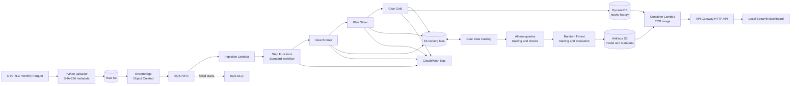

# NYC Taxi Demand Forecasting & AWS MLOps Pipeline

An event-driven data and ML pipeline that turns monthly [NYC TLC Yellow Taxi trip records](https://www.nyc.gov/site/tlc/about/tlc-trip-record-data.page) into zone-level hourly demand forecasts. It combines S3 ingestion, a three-layer Apache Iceberg lakehouse, AWS Step Functions orchestration, Glue ETL, a Random Forest model, a DynamoDB-backed inference API, and a Streamlit interface. Terraform defines the AWS infrastructure.

The practical question is: **how many pickups should a fleet expect in a given taxi zone at a given hour?** The project demonstrates ingestion with source lineage, quality gates, reproducible model evaluation, and online inference using recent demand history.

## Architecture



Terraform provisions the S3 buckets, event rule, queues, Lambdas, Step Functions state machine, Glue jobs and catalog databases, DynamoDB table, ECR repository, API Gateway routes, IAM roles, and log groups. Athena is used by the Python training and evaluation scripts to read Gold data; this repository does not create a dedicated Athena workgroup.

## Data flow and quality controls

1. **Ingest.** [`scripts/upload_raw_taxi_data.py`](scripts/upload_raw_taxi_data.py) downloads a selected month to a temporary file, computes SHA-256, uploads to `yellow/year=YYYY/month=MM/`, stores the digest and source details as S3 metadata, and checks uploaded size. It skips existing keys unless `--overwrite` is requested. The digest is recorded for lineage; Bronze reads the stored digest but does not independently rehash every object byte.
2. **Route.** An S3 object-created event reaches an EventBridge rule, then an encrypted FIFO queue. The queue buffers starts and has a dead-letter queue. The ingestion Lambda validates the bucket and object-key pattern, derives a deterministic execution name from the object identity, and starts a Standard Step Functions execution. A failed start leaves the SQS message available for retry. Once execution starts, later Glue failures are tracked by Step Functions rather than SQS.
3. **Bronze.** Glue reads the Parquet source, checks required columns and source metadata, preserves source fields and lineage, writes an Iceberg Bronze table, and records checksum, row count, and status in an ingestion ledger. A successful checksum prevents duplicate append processing.
4. **Silver.** Glue selects a successful Bronze ledger record, applies typed fields and trip validation, writes valid records to Silver and rejected records to a quarantine Iceberg table, reconciles counts, and appends a publish ledger.
5. **Gold.** Glue checks the Silver ledger and count, then builds an hourly zone-demand grid and a BI aggregate. The ML grid covers taxi zone IDs 2–263 for every hour in the month, including zero-demand hours. It verifies expected row counts, writes Iceberg Gold tables and an audit ledger, and updates hourly demand history in DynamoDB.

The [Step Functions definition](workflows/medallion_monthly.asl.json.tftpl) runs Bronze → Silver → Gold with Glue `.sync` tasks, so each stage waits for the previous job to finish. It includes bounded retries for transient Glue service errors, a failure state, and CloudWatch execution logging. Glue job failures stop downstream stages.

### Verified pipeline results

The project’s verified April 2025 run completed **S3 → EventBridge → SQS → Lambda → Step Functions → Glue**. Its reported checks are:

| Check | Result |
| --- | ---: |
| April 2025 Silver records | 3,748,509 |
| April 2025 Gold ML observations | 188,640 |
| Consecutive-hour pairs checked | 754,298 |
| Gaps greater than one hour | 0 |
| Duplicate taxi-zone/hour groups | 0 |

The 188,640 Gold rows equal 720 April hours × 262 pickup zones. DynamoDB-backed historical features and the deployed inference API were also tested successfully. These are recorded run results supplied for this release; the repository does not include cloud logs or raw data snapshots to rerun those checks offline.

## Model and evaluation

[`ml/train.py`](ml/train.py) reads the Gold `hourly_ml_observations` table through Athena, sorts records by zone and timestamp, then creates nine inputs: zone ID, hour, weekday, weekend flag, demand lags at 1/24/168 hours, and trailing 3/24-hour means. Rolling means shift demand first so the target hour is not included. Training uses records before **2025-03-01**; the original test uses records from that boundary onward. The baseline predicts the **previous day’s demand at the same hour** (`lag_24h`).

The model is a `RandomForestRegressor` with 100 trees, maximum depth 15, minimum leaf size 5, and fixed random seed 42. Predictions are floored at zero. Training writes a Joblib model, [`metrics.json`](ml/artifacts/metrics.json), and [`model_metadata.json`](ml/artifacts/model_metadata.json). Model binaries are intentionally excluded from Git; the deployed inference Lambda downloads its model from the artifacts S3 bucket.

| Metric | Original Test | April 2025 |
| --- | ---: | ---: |
| Evaluation records | 194,928 | 188,640 |
| Baseline MAE | 7.1068 | 6.1528 |
| Random Forest MAE | 3.5723 | 3.4689 |
| Random Forest RMSE | 11.0838 | 10.3541 |
| MAE improvement over baseline | 49.73% | 43.62% |

[`ml/evaluate_april.py`](ml/evaluate_april.py) loads the **existing model without retraining**, queries March and April Gold observations so April lag features have history, and evaluates April rows. The saved metadata states a February training cutoff, but this repository does not independently establish the exact provenance of the deployed binary; it therefore does not claim April was entirely unseen during all model development. Lag features in offline evaluation use observed earlier hours, so the scores describe rolling one-hour-ahead prediction with fresh history, not a forecast over many future hours without observations.

## Online inference and dashboard

The deployed container Lambda is built from [`ml/lambda_api/`](ml/lambda_api/) and pinned to scikit-learn 1.9.0. API Gateway exposes:

| Route | Behavior |
| --- | --- |
| `GET /range` | Reads the available prediction time range from DynamoDB metadata. |
| `POST /predict` | Reads the prior 168 hours for a taxi zone from DynamoDB, builds the same nine features, downloads the model from S3 on a cold start, and returns predicted rides. Missing required history produces an error. |

The local [Streamlit app](ml/frontend/app.py) provides a searchable pickup-zone selector, date and time inputs, an API request, and a predicted-rides display. Its zone lookup CSV is included. `ml/api.py` and `ml/inference.py` are local/earlier inference utilities; the Terraform deployment uses `ml/lambda_api/`.

```bash
curl "${API_URL}/range"
curl -X POST "${API_URL}/predict" \
  -H "Content-Type: application/json" \
  -d '{"pickup_location_id":161,"prediction_time":"2025-04-20T17:00:00Z"}'
```

Use a timestamp returned by `/range` and a zone with 168 prior hourly observations. The API URL is an environment-specific Terraform output, not a value committed to this repository.

## Repository layout

```text
aws/
├── terraform/                 # AWS resources, IAM, event path, Step Functions
├── workflows/                 # Active Step Functions ASL; legacy MWAA template
├── glue/jobs/                 # Bronze, Silver, Gold Spark jobs
├── lambda/data_received/      # SQS-triggered orchestration Lambda
├── scripts/                   # Monthly uploader and single-file upload helper
├── ml/                        # Features, training, April evaluation, inference
│   ├── artifacts/             # Small metric/metadata JSON only
│   ├── lambda_api/            # Deployed inference container source
│   └── frontend/              # Streamlit app and zone lookup
├── tests/smoke/               # Credential-free local contract checks
├── .env.example               # Configuration placeholders
└── README.md
```

## Prerequisites and configuration

- Python 3.12+ for local scripts; AWS CLI v2 and an authenticated AWS profile for cloud work.
- Terraform **1.7+** and the provider versions in `terraform/.terraform.lock.hcl`.
- Docker for building the inference Lambda image; an AWS account with permissions for the resources in Terraform.
- Copy `.env.example` to an untracked `.env` and set your own values. Environment files are **not loaded automatically** by these scripts; export the needed values in your shell.
- Copy `terraform/terraform.tfvars.example` to the ignored `terraform/terraform.tfvars`; set your region, project name, `force_destroy_buckets = false` for normal use, and `enable_step_functions = true` only when ready for new uploads to start paid jobs.

The public repository intentionally excludes Terraform state, provider downloads, raw Parquet data, the trained model binary, generated plans, credentials, and cloud output. The current Terraform configuration references an ECR image tagged `range-v3` and an S3 model object. **It is not a one-command bootstrap for a fresh account**: build/push the image and provide a trained model artifact before enabling the inference resources, or adapt the Terraform image/model dependency for a staged bootstrap. Keep state in a secure backend and review a fresh plan before applying. Terraform includes legacy MWAA support resources but no MWAA workflow; its `removed` block forgets a previously deleted stack state entry when migrating an existing deployment.

## Run and validate

These commands are examples; AWS writes and queries can incur charges. Run them only against an account you control after reviewing the plan and data scope.

```powershell
# From this directory; export your own profile first.
$env:AWS_PROFILE = 'your-aws-profile'
$env:AWS_REGION = 'us-east-1'
aws sts get-caller-identity
terraform -chdir=terraform init
terraform -chdir=terraform fmt -check -recursive
terraform -chdir=terraform validate
terraform -chdir=terraform plan -out review.tfplan
# Inspect the saved plan, then explicitly decide whether to apply it.
# terraform -chdir=terraform apply review.tfplan
```

For a selected month after deployment, install `scripts/requirements.txt` and run `python scripts/upload_raw_taxi_data.py --start 2025-04 --end 2025-04 --profile your-aws-profile`. The uploader skips an existing object by default; `--overwrite` creates another S3 version and can trigger processing again. The single-file PowerShell helper accepts `-FilePath`, `-Profile`, and optional `-Bucket`.

Training and April evaluation query Athena and are **not** lightweight local checks. Set `ATHENA_RESULTS_S3_URI` to an S3 path where Athena can write results; the Terraform `athena_results_s3_uri` output is a suggested location. Install `ml/requirements.txt`, then run `python -m ml.train` or `python -m ml.evaluate_april` only when the Gold data and model artifact are available. Training replaces local artifact files, so preserve any model you need first. To run the UI after a working API exists, install `ml/frontend/requirements.txt`, set `API_URL`, and run `streamlit run ml/frontend/app.py`.

Credential-free checks:

```powershell
python -m unittest discover -s tests/smoke -p 'test_*.py' -v
terraform -chdir=terraform fmt -check -recursive
terraform -chdir=terraform validate
```

## Monitoring, cleanup, and engineering notes

Check the SQS queue and DLQ, ingestion Lambda logs, Step Functions execution history and CloudWatch log group, Glue job runs, and the Bronze/Silver/Gold audit ledgers. Reconcile published row counts with Athena and verify DynamoDB history before interpreting API results. Standard Step Functions tracks a run after SQS has acknowledged its start, so later Glue failures need execution-level monitoring and manual redrive. CloudWatch log delivery is best effort.

For cleanup, first stop new uploads, inspect active executions and the plan, export any data needed, and review every S3 bucket. `force_destroy_buckets` in the example configuration should be set to `false` for normal use; Terraform destroy can otherwise remove nonempty buckets. Never use an old plan or delete state as a substitute for managing cloud resources.

Current limitations include the manual ECR/model bootstrap, no deployed SageMaker training or Model Registry, no hosted Streamlit frontend, and no authentication layer defined for the public prediction API. The FIFO queue serializes start messages, but distinct object versions can produce separate executions. Future work could add an explicit image/model release workflow, authenticated API access, failure alerts, automated data-quality assertions and model drift monitoring, and reproducible training provenance.
